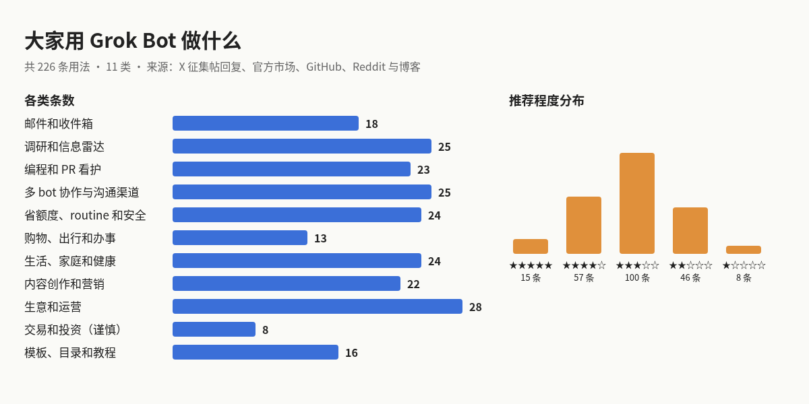

# 大家用 Grok Bot 做什么

## 背景

Grok Bot 是一种常驻的 AI 同事：每个 bot 有自己的职责、登录和一台云端电脑，可以按日程跑 routine，关掉电脑也照样干活。产品开放后，大家很快在 X 上互相问“这周你用它做成了什么”，其中 poteto 的一条征集帖收到了 1300 多条回复。同时，GitHub 上出现了收录几千个模板的目录，官方也开了模板市场，Reddit 和中文博客上有不少长篇分享。

这个仓库把这些分散的分享汇总起来，按用途分类，每条写清楚怎么做、对谁有用，并按推荐程度排序。低分的也保留，方便你自己判断。

## 分类总览

一共 **226 条**，分 11 类。推荐程度 1 到 5 星，看的是可复制性、对普通用户的价值和风险；热度来自原帖点赞数、仓库星数或来源类型。夸大收益、无法核实的条目标注了“谨慎”。

| 章 | 分类 | 条数 |
| --- | --- | --- |
| 1 | [邮件和收件箱](chapters/01-mail.md) | 18 |
| 2 | [调研和信息雷达](chapters/02-radar.md) | 25 |
| 3 | [编程和 PR 看护](chapters/03-code.md) | 23 |
| 4 | [多 bot 协作与沟通渠道](chapters/04-team.md) | 25 |
| 5 | [省额度、routine 和安全](chapters/05-ops.md) | 24 |
| 6 | [购物、出行和办事](chapters/06-buy.md) | 13 |
| 7 | [生活、家庭和健康](chapters/07-life.md) | 24 |
| 8 | [内容创作和营销](chapters/08-content.md) | 22 |
| 9 | [生意和运营](chapters/09-biz.md) | 28 |
| 10 | [交易和投资（谨慎）](chapters/10-trade.md) | 8 |
| 11 | [模板、目录和教程](chapters/11-meta.md) | 16 |
| 12 | [先扫版：4 星和 5 星](chapters/12-top-picks.md) | 72 |
| 13 | [怎么用到自己身上](chapters/13-apply.md) | — |

每章是一张表，列为：编号、用法、做法与价值、热度、推荐程度、来源。

## 用到的征集帖

| 征集帖 | 原帖回复数 | 收录方式 |
| --- | --- | --- |
| [@poteto：what did you get done this week with @bot?](https://x.com/poteto/status/2108808972954423578) | 1327 | 读取了其中 292 条回复 |
| [@ericzakariasson：how are you using grok bot this weekend?](https://x.com/ericzakariasson/status/2101790601092243741) | 67 | 读取了可检索到的 23 条回复 |
| [@hello_code_：Is anyone actually using Grok Bot?](https://x.com/hello_code_/status/2100427658194522547) | 48 | 读取了可检索到的 25 条回复 |
| [r/GrokBot：What's the most useful Grokbot automation you've built?](https://www.reddit.com/r/GrokBot/comments/1wiuwmw/whats_the_most_useful_grokbot_automation_youve/) | — | 摘录了主要回复 |

此外还用了 X 关键词搜索（中英日）、xAI 官方模板市场、GitHub 仓库和 Reddit、Substack、中文博客等，完整列表见 [sources.md](sources.md)。

## 意义与启示

- **最受欢迎的不是最炫的。** 点赞高的多是邮件分诊、收藏回顾、PR 审查这类小而稳的活，而不是“全自动赚钱”。
- **边界比能力更重要。** 好用法几乎都是“bot 读和起草，人来发送和付款”，并用独立邮箱、转发触发、受限账号缩小权限。
- **额度和可靠性是真实成本。** 高频 routine 很贵，夜间 routine 偶尔漏跑，重要的事要留人工检查点。
- **模板是起点，不是终点。** 几千个公开模板可以直接导入，但长期有用的往往是按自己的痛点改过的。

怎么开始，见最后一章 [怎么用到自己身上](chapters/13-apply.md)。
